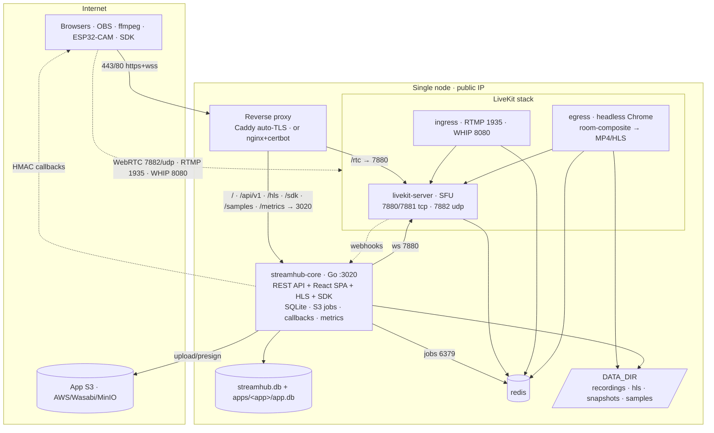

# StreamHub — Architecture (overview)

StreamHub is a **management layer over a self-hosted [LiveKit](https://livekit.io) SFU** that
makes a plain LiveKit deployment behave like AntMedia: tenancy by **apps**, per-app S3
recording, its own REST API (global + per-app), embeddable players + a browser SDK, adaptive
transcoding, structured logs, snapshots, signed callbacks, RBAC + quotas and Prometheus
metrics — behind a **single domain** with automatic TLS.

This file is the top-level map. The **full, diagrammed architecture** lives in
[`streamhub-docs/architecture/`](https://streamhub.studio/docs/architecture/README); operations
runbooks live in [`streamhub-docs/operations/`](https://streamhub.studio/docs/operations/README).

> **Naming:** product = **StreamHub**; repo = `vision-media-server`. On the production host
> `stream01` some dirs/units still carry the historical `skyline-*` prefix (aliases).

## Single node (today)

**Ports:** 80/443 (proxy), 7880/7881 tcp + 7882 udp (LiveKit media), 1935 (RTMP), 8080
(WHIP), 3478 udp (embedded TURN, optional), 3020 (core, local), 6379 (redis, local).

**Processes:** `livekit`, `ingress`, `egress`, `redis`, `streamhub-core` (one static **Go**
binary from `streamhub-core-go/`; serves API + compiled React SPA + HLS + SDK + samples +
`/metrics`). Two deploy shapes: **Docker Compose + Caddy** (default) or **systemd + nginx +
certbot** (plain-server: `deploy/make-core-bundle.sh` + `deploy/deploy-core.sh`). Details →
[architecture/services.md](https://streamhub.studio/docs/architecture/services).

**The core (3.x) is Go.** The NestJS core (2.x) was retired from `main` (branch
`legacy/node-2.x`, tag `2.24.0`); its responses to the parity corpus are recorded in
`streamhub-core-go/test/parity/golden/` and `cmd/parity` replays every route against Go
(status, headers, normalized JSON — CI job `parity`). The Go core opens the 2.x
`DATA_DIR` and SQLite schema unchanged, reads the same `.env`, and keeps every `/api/v1`
contract; deliberate deviations (Node bugs fixed, security hardening, irreproducible runtime
facts) are listed in internal design notes.

## Data — per-app SQLite

A **minimal global** `data/streamhub.db` (tenants, users, memberships, quotas, api_tokens,
`nodes` cluster registry, `apps` pointer, server_logs) + **one `apps/<app>/app.db` per app**
owning all app-scoped state (streams, vods, ingress_auth). The global→per-app **split
migration** runs idempotently at boot after a `VACUUM INTO` backup of the global DB. Full ERD
+ flow → [architecture/data-model.md](https://streamhub.studio/docs/architecture/data-model).

## Target cluster (origin + edge)

Single-node today; designed for an **origin (master) + edge** cluster: a `nodes` registry +
**join by cluster-token + IP**, WebRTC **session affinity** (LiveKit pins a room to one node
via shared redis), a control-plane **router**, and pooled ingress/egress workers.
**Reality check:** WebRTC does not scale to 100k+ viewers — the design pairs **origin WebRTC
(interactive)** with **LL-HLS + CDN (mass audience)**. Full design →
[architecture/cluster.md](https://streamhub.studio/docs/architecture/cluster).

## Observability

streamhub-core exposes Prometheus at `/metrics` (root path; optional `METRICS_TOKEN`);
LiveKit exposes its own native metrics (`prometheus_port`). Prometheus scrapes both, Grafana
on top. Catalog + setup →
[operations/OBSERVABILITY.md](https://streamhub.studio/docs/operations/OBSERVABILITY).

## See also

- Operations: [DEPLOY](https://streamhub.studio/docs/operations/DEPLOY) ·
  [RUNBOOK](https://streamhub.studio/docs/operations/RUNBOOK) ·
  [ENV](https://streamhub.studio/docs/operations/ENV)
- API & config: [docs](https://streamhub.studio/docs/README)
